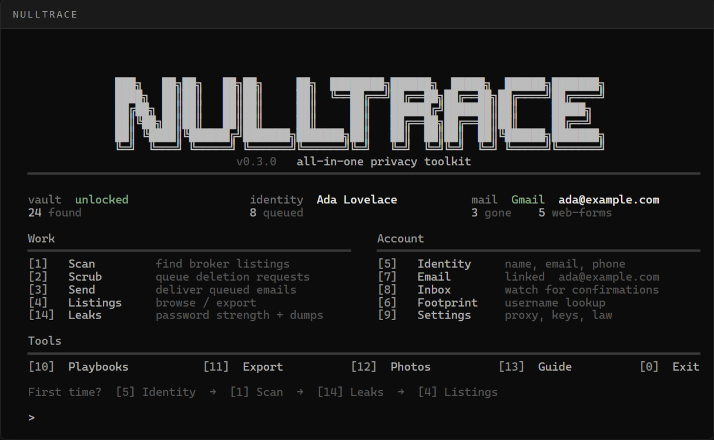
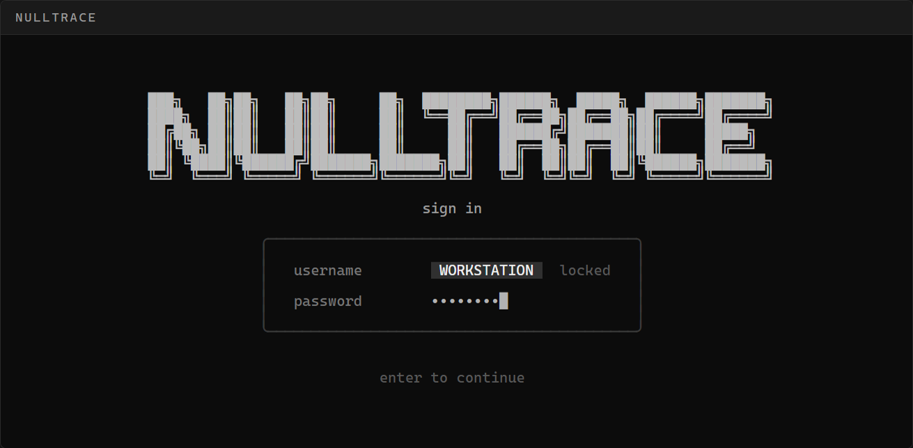

<div align="center">

# NullTrace

**Opt out of 400+ data brokers from one app that never leaves your machine.**

NullTrace matches the name, email and phone you give it against a catalog of people-search and marketing brokers, queues CCPA / GDPR deletion requests, sends them from a mailbox you already own, and checks your passwords against public breach dumps. Everything is stored in an encrypted vault on your computer. There is no NullTrace account and no NullTrace server.

[](https://github.com/ide-digital/nulltrace/actions)
[](https://github.com/ide-digital/nulltrace/releases)
[](source/go.mod)
[](LICENSE)

[Download](https://github.com/ide-digital/nulltrace/releases) · [Quick start](#quick-start) · [What leaves your machine](#what-leaves-your-machine) · [Contributing](#contributing)



</div>

## Why

Your address, phone number and relatives are probably listed on dozens of people-search sites. Getting removed means finding every broker, sending each one a legal deletion request, and tracking who actually complied. NullTrace does the tedious parts and keeps a record, without handing your identity to yet another company.

## What it does

| | |
|---|---|
| **Scan** | Scores your identity against a maintained catalog of 400+ people-search sites, data brokers and ad-tech aggregators, and shows which ones are worth a request. |
| **Scrub & Send** | Builds CCPA / CPRA, GDPR and state-law deletion emails from local templates and sends them through your own Gmail, Outlook or Yahoo account. |
| **Inbox** | Optionally watches the same mailbox over IMAP for broker confirmations, so you can see who actually removed you. It only follows confirmation links that stay on that broker's own domain. |
| **Playbooks** | Step-by-step guides for brokers that only accept a web form. |
| **Leaks** | Scores password strength locally, checks a common-password list, and looks up breach dumps without sending the password. |
| **Footprint** | Looks up where a username is registered. |
| **Vault** | Mailbox passwords and API keys live in an encrypted local file (Argon2id + XChaCha20-Poly1305), never in plain config. |

## What leaves your machine

By default, almost nothing.

- **Scan is not a live crawl.** It matches against the broker catalog bundled in this repo. It does not search the web for you.
- **Password checks use k-anonymity.** Only the first five hex characters of `SHA-1(password)` are sent to the public Pwned Passwords range API. The full password and full hash stay local. NullTrace does not ask Have I Been Pwned which *accounts* were breached; that API needs a key.
- **Mail goes through your own mailbox.** You paste in an App Password; SMTP is tested before it is saved. There is no OAuth app and no NullTrace inbox.
- **Browser automation and CAPTCHA helpers ship disabled.** By default it's just a catalog match and a templated email sent from your account.

Details and the threat model are in [SECURITY.md](SECURITY.md).

## Quick start

### Download

Grab the build for your OS from the [latest release](https://github.com/ide-digital/nulltrace/releases/latest).

**Windows:** unzip `NullTrace-windows-amd64.zip`, keep `NullTrace.exe` next to the `app` folder, and double-click. The exe isn't code-signed yet, so SmartScreen may ask first ("More info", then "Run anyway").

**Linux:**

```sh
tar -xzf nulltrace-linux-amd64.tar.gz    # or linux-arm64
./nulltrace-linux-amd64/nulltrace
```

**macOS:**

```sh
tar -xzf nulltrace-darwin-arm64.tar.gz   # darwin-amd64 on Intel Macs
cd nulltrace-darwin-arm64
xattr -d com.apple.quarantine nulltrace nulltraced   # not notarized yet
./nulltrace
```

### Build from source (Linux, macOS, Windows)

Go 1.23+ with CGO off. Same binary on every platform:

```sh
git clone https://github.com/ide-digital/nulltrace.git
cd nulltrace/source
go build -trimpath -ldflags="-s -w" -o nulltrace ./cmd/nulltrace
./nulltrace
```

Windows launcher from source:

```powershell
git clone https://github.com/ide-digital/nulltrace.git
cd nulltrace
powershell -File source\build.ps1
.\NullTrace.exe
```

### First run

The first launch shows a loading bar, then asks you to create a login. The username is your computer name and is locked on purpose; the password is the key to your vault.

<div align="center">

</div>

Then work through the home menu:

1. **[5] Identity**: the name, email and phone people-search sites actually have on you
2. **[1] Scan**: match that identity against the catalog
3. **[4] Listings**: browse, search and export the matches
4. **[7] Email**: link Gmail, Outlook or Yahoo with an App Password (your normal mailbox password will not work)
5. **[2] Scrub**, then **[3] Send**: queue and deliver the deletion requests
6. **[10] Playbooks**: handle brokers that only offer a web form
7. **[14] Leaks**: optional password check

Nested screens use `[0] back` and `[m] main menu`. The identity form validates names, email, phone, date of birth and city; leave a field blank to skip it.

### Running it as a service

`nulltraced` keeps the vault unlocked on a box while the CLI talks to it on `127.0.0.1:7738`. See `source/docker-compose.yml` and `source/scripts/systemd/nulltraced.service`. `source/scripts/install.sh` (or `make install`) builds `nulltrace` and `nulltraced` into `/usr/local/bin`, using sudo only if it has to, and sets the daemon up as a systemd *user* service so it never runs as root. The daemon leaves queued mail alone until a mailbox is linked.

## Where files live

| | Windows | Linux / macOS |
|---|---|---|
| Vault | `%LocalAppData%\nulltrace` | `$XDG_DATA_HOME/nulltrace` (usually `~/.local/share/nulltrace`) |
| Config | `%AppData%\nulltrace` | `$XDG_CONFIG_HOME/nulltrace` (usually `~/.config/nulltrace`) |

Config is YAML (`source/config.example.yaml` shows the default shape). Mailbox passwords, HIBP keys and CapSolver keys go in the vault with `nulltrace secret set`, not in the YAML. Deletion templates (CCPA, GDPR, state) live in `source/internal/engine/mailer/templates/`, and the jurisdiction is a setting.

## Contributing

The broker catalog is YAML in [`source/internal/broker/data/`](source/internal/broker/data). Opt-out pages change constantly, so **a pull request that adds a broker or fixes a stale opt-out URL is the most useful contribution there is.** Include a source for the URL or privacy address.

```sh
cd source
go test ./...
```

On Windows the console is pinned to the window size rather than the 3000-row scrollback buffer, which used to smear the login field. If you touch `source/internal/tui/login.go` or `source/cmd/nulltrace/console_windows.go`, keep the login tests green.

Never commit a vault, `daemon.token`, `.env`, real identity data or screenshots of a live vault. See [CONTRIBUTING.md](CONTRIBUTING.md).

## Security

Found something that looks like a vault bypass or a crypto bug? Please report it privately through [GitHub security advisories](https://github.com/ide-digital/nulltrace/security/advisories/new), not a public issue. See [SECURITY.md](SECURITY.md).

## License

[MIT](LICENSE)

---

<div align="center">

Built and maintained by [IDE Digital](https://ide.digital), development for agencies and founders.

</div>
